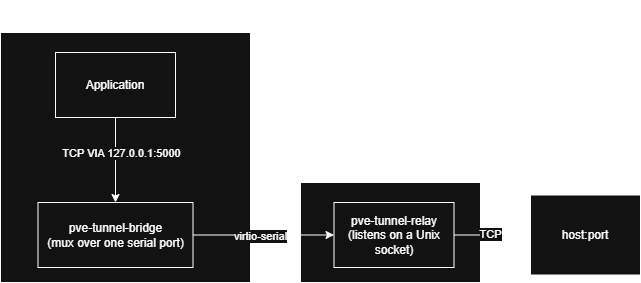
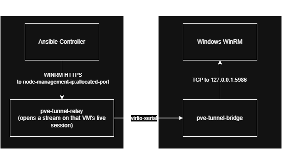

# pveTunnel

> AI was used in the development of this project.

NIC-less TCP transport for Proxmox VE guests. pveTunnel carries connections from a
guest's loopback interface over a **virtio-serial** port to a relay on the Proxmox
node, then forwards them to a configurable TCP service. Guests need no visible
network adapter, multiple concurrent connections share one serial port, and QEMU
automatically reconnects the channel after live migration.

The tunnel is application-agnostic: it forwards raw TCP bytes and does not inspect
or modify application protocols, headers, authentication, or identity.

## How it works



- Loopback exists without a NIC, so an application can connect to the local bridge.
- The guest bridge multiplexes concurrent TCP connections over one virtio-serial port.
- One relay per Proxmox node de-multiplexes each guest's streams into TCP connections
  to the configured target.
- The relay derives the VMID from QEMU peer credentials, and uses it both for log
  tagging and to decide which configuration applies to that guest.

### Reverse ingress: management traffic into the guest

The channel also carries connections in the opposite direction, which is what lets
Ansible manage a guest that has no exercise NIC:



Both directions share one session. Stream ids are partitioned by parity, so the
relay-initiated management streams cannot collide with guest-initiated ones.

**No target address ever travels on the wire.** The relay learns its egress target from
the root-owned VM registry keyed by VMID; the bridge learns its ingress target from its
own local configuration. VM identity likewise comes from `SO_PEERCRED` and the QEMU
command line on the host, never from anything the guest sends.

Be precise about what that buys, because there are two different claims here and only
one of them is enforced by this code:

- **Host side, enforced.** A guest cannot choose where the relay connects. It cannot
  name an egress target, reach another VM's streams, or claim another VMID. Every
  routing decision on the node is made from host state.
- **Guest side, trusted.** The stock bridge refuses any ingress target that is not
  loopback, so a misconfiguration cannot point controller traffic at a routable
  address. That is a check inside a binary the guest owns. A trainee with local
  administrator rights can replace that binary and send the bytes wherever they like.
  Nothing in the tunnel can prevent it, and note that Ludus sets
  `ansible_winrm_server_cert_validation: ignore`, so a redirected WinRM stream is worth
  treating as credential exposure.

In other words, omitting the target from the wire stops a guest steering the *relay*.
It does not make a compromised guest safe, and constraining that needs guest or network
isolation outside this component.

The controller-facing port is bound only while that VM's session is live, and is
refused outright on a wildcard address: guest management must never be reachable from
an exercise VLAN.

## Projects

| Project | Runs on | Purpose |
|---|---|---|
| `PveTunnel.Mux` | library | Stream-multiplexing wire protocol with credit-based flow control |
| `PveTunnel.Bridge` | guest (Windows/Linux) | Loopback TCP to virtio-serial bridge |
| `PveTunnel.Relay` | each Proxmox node | Virtio-serial socket to target TCP relay |
| `PveTunnel.Mux.Tests` | development host | Multiplexer unit tests |
| `PveTunnel.Relay.Tests` | development host | Registry validation, ingress, isolation, status |

## Configuration

Bridge environment variables:

| Variable | Default | Purpose |
|---|---|---|
| `PVE_TUNNEL_LISTEN` | `127.0.0.1:5000` | Guest loopback endpoint (egress) |
| `PVE_TUNNEL_INGRESS_TARGET` | `127.0.0.1:5986` | Guest management target for inbound streams; must be loopback |
| `PVE_TUNNEL_INGRESS_ENABLED` | enabled | Set `0`/`false` to refuse inbound streams |
| `PVE_TUNNEL_PORT_NAME` | `pve-tunnel.relay.0` | Virtio-serial port name |
| `PVE_TUNNEL_PORT_PATH` | OS-specific | Full serial device path override |

Relay environment variables:

| Variable | Default | Purpose |
|---|---|---|
| `PVE_TUNNEL_SOCKET` | `/run/pve-tunnel/relay.sock` | QEMU-facing Unix socket |
| `PVE_TUNNEL_REGISTRY` | `/etc/pve/pve-tunnel/vms.json` | Root-owned VM registry; required |
| `PVE_TUNNEL_ALLOW_NO_REGISTRY` | unset | Set `1` to run single-target mode with no registry |
| `PVE_TUNNEL_TARGET` | `127.0.0.1:5000` | Egress target in single-target mode only |
| `PVE_TUNNEL_INGRESS_BIND` | `127.0.0.1` | Controller-facing bind address |
| `PVE_TUNNEL_CONTROL_SOCKET` | `/run/pve-tunnel/control.sock` | Root-only status socket |

### VM registry

The registry maps each VMID to its allocated management port and fixed targets. It
normally lives on the Proxmox cluster filesystem so a live migration can rebind the
same allocation on the destination node. See `deploy/vms.example.json`.

The relay is strictly a **consumer** of port allocations and never invents one. Choosing
the allocator is a separate design decision; what happens here is validation, and the
relay refuses to start on anything ambiguous -- a duplicate port, a duplicate VMID, a
hostname instead of a literal IP, or a non-loopback guest management target. A port
claimed by two VMs would route one VM's management traffic into another VM's guest,
so there is no safe way to pick a winner.

The registry is required. If it is missing the relay refuses to start, because a
missing file is far more likely to be a typo, an unmounted `/etc/pve`, or a failed
deploy than a deliberate choice -- and falling back silently would turn authoritative
per-VM policy into one global egress target with nobody told. Single-target mode is
still available for a deployment that genuinely has no registry, but only by setting
`PVE_TUNNEL_ALLOW_NO_REGISTRY=1`; ingress is off for every VM in that mode.

With a registry present it is authoritative: a VM missing from it gets no streams in
either direction.

### Connection bounds

Controller connections share the VM's stream budget with its own GHOSTS traffic, so
ingress is bounded per VM: at most 32 concurrent controller connections, a 10 second
deadline to obtain a mux stream, and a 5 minute idle timeout. Excess connections are
refused immediately rather than queued. Without these, connections that merely sit
there would exhaust the session's stream cap and starve the guest in both directions.

### Status

```bash
sudo socat - UNIX-CONNECT:/run/pve-tunnel/control.sock
```

Returns one JSON object listing every configured and connected VM, its bound ingress
port, and whether it is `ready` -- meaning the session is live and, where ingress is
configured, a port is bound for the controller to reach. The socket is read-only and
mode 0600; there are no commands.

## Build and test

```bash
dotnet test pve-tunnel.slnx

# Relay for a Proxmox node (self-contained; no .NET runtime required)
dotnet publish PveTunnel.Relay -c Release -r linux-x64 --self-contained -p:PublishSingleFile=true

# Bridge for the required guest OS
dotnet publish PveTunnel.Bridge -c Release -r win-x64 --self-contained -p:PublishSingleFile=true
dotnet publish PveTunnel.Bridge -c Release -r linux-x64 --self-contained -p:PublishSingleFile=true
```

## EXERCISE INFRASTRUCTURE — OUT OF SCOPE FOR BLUE TEAM

The deployment artifacts below are range infrastructure, not a covert channel or a Blue Team
investigation target. Preserve the visible `EXERCISE-OUT-OF-SCOPE` labels in installed paths,
process names, service names, scheduled tasks, logs, notices, and operator documentation.

## Deploy

On each Proxmox node:

1. Copy the stable published `pve-tunnel-relay` assembly to
   `/opt/ludus/EXERCISE-OUT-OF-SCOPE/pve-tunnel/EXERCISE-OUT-OF-SCOPE-pve-tunnel-relay`.
2. Set `PVE_TUNNEL_TARGET` in `deploy/pve-tunnel-relay.service`.
3. Install `deploy/pve-tunnel-relay.service` as
   `/etc/systemd/system/EXERCISE-OUT-OF-SCOPE-pve-tunnel-relay.service` and
   `deploy/pve-tunnel.conf` as
   `/etc/tmpfiles.d/EXERCISE-OUT-OF-SCOPE-pve-tunnel.conf`.
4. Run `systemctl daemon-reload` and
   `systemctl enable --now EXERCISE-OUT-OF-SCOPE-pve-tunnel-relay.service`.

For each guest template:

1. Add the line in `deploy/qemu-args.snippet.txt` to the VM configuration.
2. Install the virtio-serial driver in Windows guests.
3. Publish and install the bridge. Windows guests can use
   `deploy/install-bridge-windows.ps1`; Linux guests can install
   `deploy/pve-tunnel-bridge.service` as
   `/etc/systemd/system/EXERCISE-OUT-OF-SCOPE-pve-tunnel-bridge.service`, with the stable
   published binary copied to
   `/opt/ludus/EXERCISE-OUT-OF-SCOPE/pve-tunnel/EXERCISE-OUT-OF-SCOPE-pve-tunnel-bridge`.
4. Point the application at the bridge's loopback endpoint.

The QEMU arguments are identical for every VM and can be baked into a template.

### Port-name contract

`pve-tunnel.relay.0` is a host/guest contract: the QEMU `virtserialport` name,
`PVE_TUNNEL_PORT_NAME`, and the guest device path must match exactly. Template and relay versions
must therefore agree on the name. The proposed 40-character replacement
must be applied atomically across QEMU arguments, bridge defaults, guest device paths, and
documentation. Its length and character set have not yet been validated against the Windows
`vioser` driver; that remains an explicit work package 4 template-build acceptance check.
